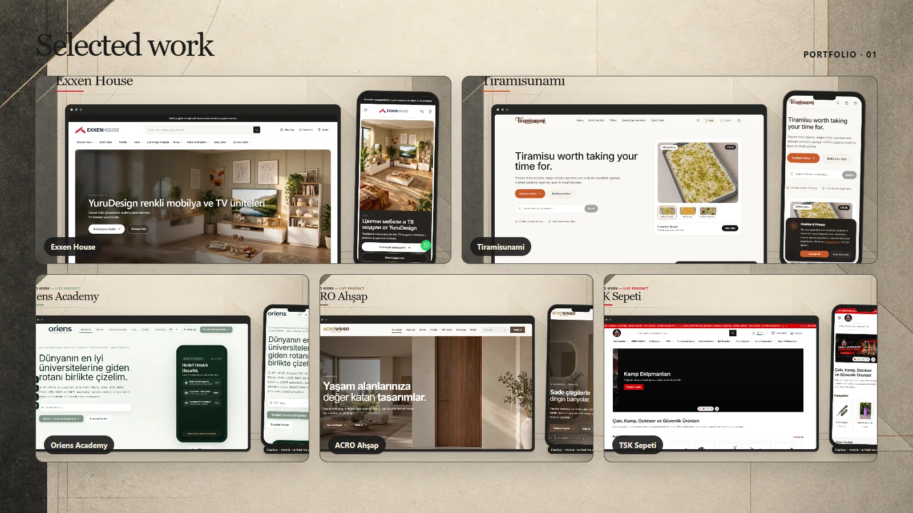
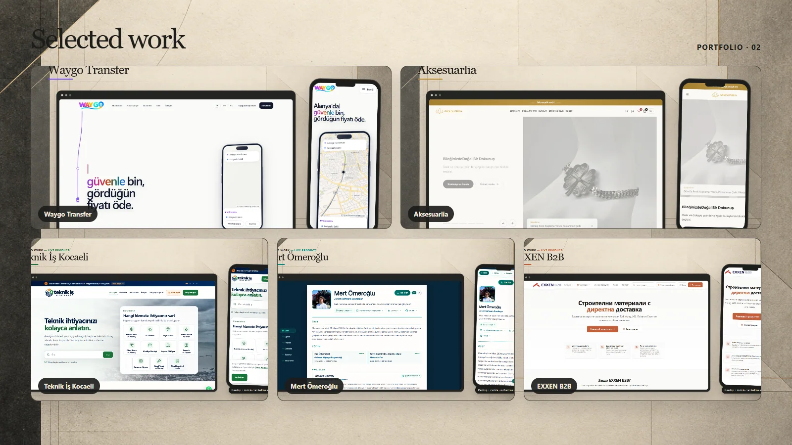

  

I build web products, mobile applications, e-commerce experiences, and custom business software—from customer-facing interfaces to the systems behind them.

### Working with

  
  &nbsp;
  
  &nbsp;
  
  &nbsp;
  
  &nbsp;
  
  &nbsp;
  

### Selected work

| Project | Focus | Links |
| --- | --- | --- |
| **Exxen House** | Furniture commerce | [Showcase](https://github.com/mertomeroglu/exxenhouse-showcase) · [Live](https://exxenhouse.com) |
| **Tiramisunami** | Artisan food commerce | [Showcase](https://github.com/mertomeroglu/tiramisunami-showcase) · [Live](https://tiramisunami.com) |
| **Oriens Academy** | Education and consultancy | [Showcase](https://github.com/mertomeroglu/oriens-academy-showcase) · [Live](https://oriens-academy.com) |
| **ACRO Ahşap** | Interior product catalogue | [Showcase](https://github.com/mertomeroglu/acroahsap-showcase) · [Live](https://acroahsap.com) |
| **TSK Sepeti** | Outdoor e-commerce | [Showcase](https://github.com/mertomeroglu/tsksepeti-showcase) · [Live](https://tsksepeti.com) |

| Project | Focus | Links |
| --- | --- | --- |
| **Waygo Transfer** | Mobility platform | [Showcase](https://github.com/mertomeroglu/waygo-transfer-showcase) · [Live](https://waygotransfer.com) |
| **Aksesuarlia** | Fashion and accessories commerce | [Showcase](https://github.com/mertomeroglu/aksesuarlia-showcase) · [Live](https://aksesuarlia.com) |
| **Teknik İş Kocaeli** | Local service marketplace | [Showcase](https://github.com/mertomeroglu/teknik-is-kocaeli-showcase) · [Live](https://teknikiskocaeli.com) |
| **Mert Ömeroğlu** | Developer portfolio | [Showcase](https://github.com/mertomeroglu/mertomeroglu-com-showcase) · [Live](https://mertomeroglu.com) |
| **EXXEN B2B** | Construction-material B2B | [Showcase](https://github.com/mertomeroglu/exxenb2b-showcase) · [Live](https://exxenb2b.com) |

### Contact

[Portfolio](https://mertomeroglu.com) · [LinkedIn](https://www.linkedin.com/in/mertomeroglu/) · [Email](mailto:mertomeroglu7@hotmail.com)

  

Technology icons are sourced from Devicon. See [third-party notices](THIRD_PARTY_NOTICES.md).
