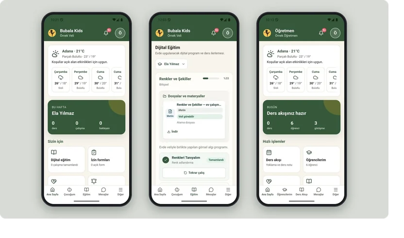
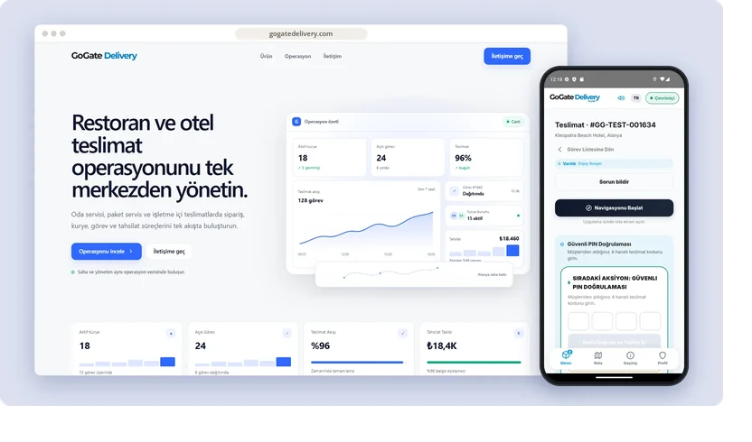
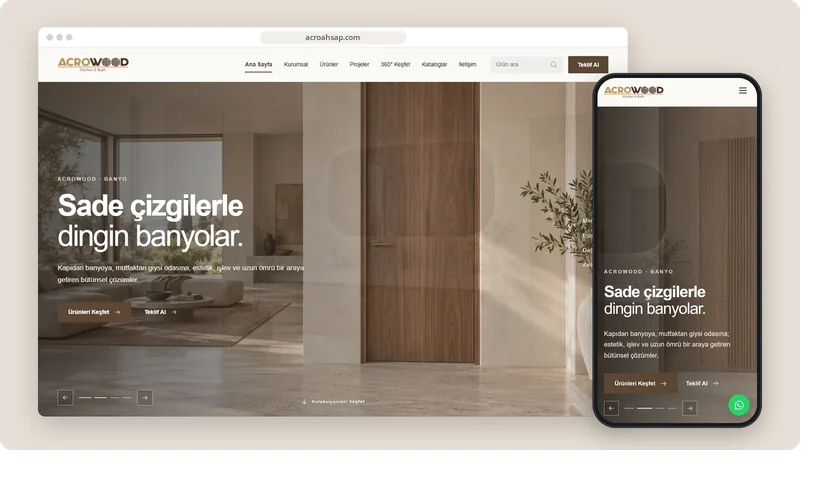

<a href="https://mertomeroglu.com"><picture><source media="(prefers-color-scheme: dark)" srcset="assets/intro-dark.svg"><source media="(prefers-color-scheme: light)" srcset="assets/intro-light.svg"></picture></a>

I build **web products**, **mobile apps**, **e-commerce stores** and **custom business software** — from the interface people use to the systems behind it.

[mertomeroglu.com](https://mertomeroglu.com) &nbsp;·&nbsp; [LinkedIn](https://www.linkedin.com/in/mertomeroglu) &nbsp;·&nbsp; [mert@mertomeroglu.com](mailto:mert@mertomeroglu.com)

## Selected work

### [Bubala Kids](https://github.com/mertomeroglu/bubala-kids-showcase)

Child development platform where parents, teachers and coordinators follow assessments, goals, sessions and progress reports.

React · Fastify · PostgreSQL · Capacitor

[bubalakidsapp.com ↗︎](https://bubalakidsapp.com) &nbsp;·&nbsp; [Showcase →](https://github.com/mertomeroglu/bubala-kids-showcase)

 

### [GoGate Delivery](https://github.com/mertomeroglu/gogate-delivery-showcase)

Delivery operations for restaurants, hotels and resorts — orders, couriers and collections in one flow, with a courier app.

ASP.NET Core · PostgreSQL · SignalR · React · Capacitor

[gogatedelivery.com ↗︎](https://gogatedelivery.com) &nbsp;·&nbsp; [Showcase →](https://github.com/mertomeroglu/gogate-delivery-showcase)

 

### [Tiramisunami](https://github.com/mertomeroglu/tiramisunami-showcase)

Artisan tiramisu shop built around menu discovery, custom boxes, chilled delivery and order tracking.

Next.js · TypeScript · Express · Socket.IO

[tiramisunami.com ↗︎](https://tiramisunami.com) &nbsp;·&nbsp; [Showcase →](https://github.com/mertomeroglu/tiramisunami-showcase)

 

### [Acro Ahşap](https://github.com/mertomeroglu/acroahsap-showcase)

Visual product catalogue for doors, kitchens, bathrooms, wardrobes and interior living solutions.

Next.js · TypeScript · Supabase

[acroahsap.com ↗︎](https://acroahsap.com) &nbsp;·&nbsp; [Showcase →](https://github.com/mertomeroglu/acroahsap-showcase)

 

## More projects

Names open the showcase · domains open the live site

**Commerce**

- [**Exxen House**](https://github.com/mertomeroglu/exxenhouse-showcase) — Furniture store organised by room, collection and category · [exxenhouse.com ↗︎](https://exxenhouse.com)
- [**Aksesuarlia**](https://github.com/mertomeroglu/aksesuarlia-showcase) — Boutique store for leather bags, natural-stone jewellery and accessories · [aksesuarlia.com ↗︎](https://aksesuarlia.com)
- [**TSK Sepeti**](https://github.com/mertomeroglu/tsksepeti-showcase) — Online store for knives, outdoor, camping and security gear · [tsksepeti.com ↗︎](https://tsksepeti.com)

**Platforms & services**

- [**WayGo Transfer**](https://github.com/mertomeroglu/waygo-transfer-showcase) — Multilingual fixed-price transfer platform for Antalya · [waygotransfer.com ↗︎](https://waygotransfer.com)
- [**Exxen B2B**](https://github.com/mertomeroglu/exxenb2b-showcase) — B2B platform for construction materials, quotations and delivery in Bulgaria · [exxenb2b.com ↗︎](https://exxenb2b.com)
- [**Teknik İş Kocaeli**](https://github.com/mertomeroglu/teknik-is-kocaeli-showcase) — Service-request platform for local technical work in Kocaeli · [teknikiskocaeli.com ↗︎](https://teknikiskocaeli.com)

**Education & portfolio**

- [**Oriens Academy**](https://github.com/mertomeroglu/oriens-academy-showcase) — International exam preparation and academic consultancy · [oriens-academy.com ↗︎](https://oriens-academy.com)
- [**Mert Ömeroğlu**](https://github.com/mertomeroglu/mertomeroglu-com-showcase) — Bilingual developer portfolio · [mertomeroglu.com ↗︎](https://mertomeroglu.com)

## Stack

  &nbsp;
  &nbsp;
  &nbsp;
  &nbsp;
  &nbsp;
  

- **Frontend** — TypeScript, React, Next.js, Tailwind CSS
- **Mobile** — Capacitor
- **Backend & data** — Node.js (Express, Fastify), ASP.NET Core, PostgreSQL, Supabase, Redis, Docker
- **Commerce** — Shopify (Liquid)

---

Each project links to a presentation-only showcase repository; application source stays private. Icons and fonts: see [third-party notices](THIRD_PARTY_NOTICES.md).
