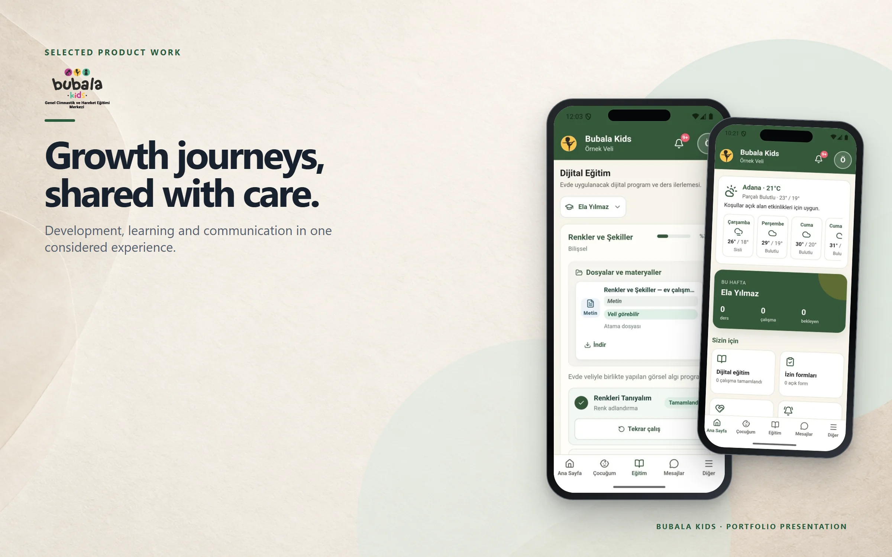
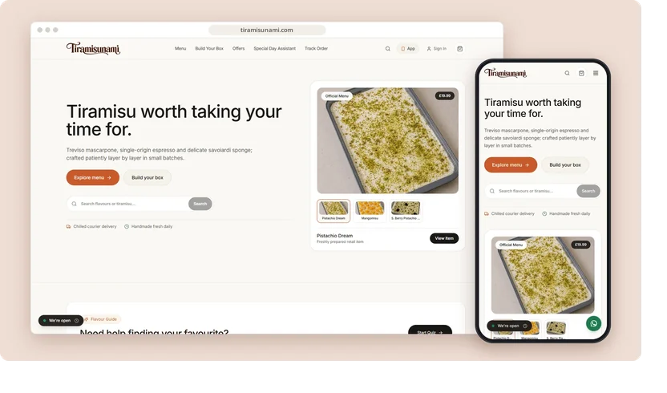

<a href="https://mertomeroglu.com"><picture><source media="(prefers-color-scheme: dark)" srcset="assets/banner-dark.svg"><source media="(prefers-color-scheme: light)" srcset="assets/banner-light.svg"></picture></a>

I build web products, mobile applications, e-commerce stores and custom business software — from the interface people use to the systems behind it.

**[mertomeroglu.com](https://mertomeroglu.com)** &nbsp;·&nbsp; [LinkedIn](https://www.linkedin.com/in/mertomeroglu) &nbsp;·&nbsp; [mert@mertomeroglu.com](mailto:mert@mertomeroglu.com)

### Selected work

**Bubala Kids** — A child development platform where parents, teachers and coordinators follow each child's assessments, goals, sessions and progress reports. 
[Showcase](https://github.com/mertomeroglu/bubala-kids-showcase) &nbsp;·&nbsp; [bubalakidsapp.com](https://bubalakidsapp.com)

**GoGate Delivery** — Delivery operations for restaurants, hotels and resorts — orders, couriers, tasks and collections managed in one flow. 
[Showcase](https://github.com/mertomeroglu/gogate-delivery-showcase) &nbsp;·&nbsp; [gogatedelivery.com](https://gogatedelivery.com)

**Tiramisunami** — An artisan tiramisu shop built around menu discovery, custom boxes, chilled delivery and order tracking. 
[Showcase](https://github.com/mertomeroglu/tiramisunami-showcase) &nbsp;·&nbsp; [tiramisunami.com](https://tiramisunami.com)

**Acro Ahşap** — A visual product catalogue for doors, kitchens, bathrooms, wardrobes and interior living solutions. 
[Showcase](https://github.com/mertomeroglu/acroahsap-showcase) &nbsp;·&nbsp; [acroahsap.com](https://acroahsap.com)

### More projects

**Commerce**

- [Exxen House](https://github.com/mertomeroglu/exxenhouse-showcase) — Furniture store organised by room, collection and category · [exxenhouse.com](https://exxenhouse.com)
- [Aksesuarlia](https://github.com/mertomeroglu/aksesuarlia-showcase) — Boutique store for leather bags, natural-stone jewellery and accessories · [aksesuarlia.com](https://aksesuarlia.com)
- [TSK Sepeti](https://github.com/mertomeroglu/tsksepeti-showcase) — Online store for knives, outdoor, camping and security gear · [tsksepeti.com](https://tsksepeti.com)

**Platforms & services**

- [WayGo Transfer](https://github.com/mertomeroglu/waygo-transfer-showcase) — Multilingual fixed-price transfer platform for Antalya · [waygotransfer.com](https://waygotransfer.com)
- [Exxen B2B](https://github.com/mertomeroglu/exxenb2b-showcase) — B2B platform for construction materials, quotations and delivery in Bulgaria · [exxenb2b.com](https://exxenb2b.com)
- [Teknik İş Kocaeli](https://github.com/mertomeroglu/teknik-is-kocaeli-showcase) — Service-request platform for local technical work in Kocaeli · [teknikiskocaeli.com](https://teknikiskocaeli.com)

**Education & portfolio**

- [Oriens Academy](https://github.com/mertomeroglu/oriens-academy-showcase) — International exam preparation and academic consultancy · [oriens-academy.com](https://oriens-academy.com)
- [Mert Ömeroğlu](https://github.com/mertomeroglu/mertomeroglu-com-showcase) — Bilingual developer portfolio · [mertomeroglu.com](https://mertomeroglu.com)

### Stack

  &nbsp;
  &nbsp;
  &nbsp;
  &nbsp;
  &nbsp;
  

- **Frontend** — TypeScript, React, Next.js, Tailwind CSS
- **Mobile** — Capacitor
- **Backend & data** — Node.js (Express, Fastify), ASP.NET Core, PostgreSQL, Supabase, Redis, Docker
- **Commerce** — Shopify (Liquid)

---

Each project links to a presentation-only showcase repository; application source stays private. Icons and fonts: see [third-party notices](THIRD_PARTY_NOTICES.md).
